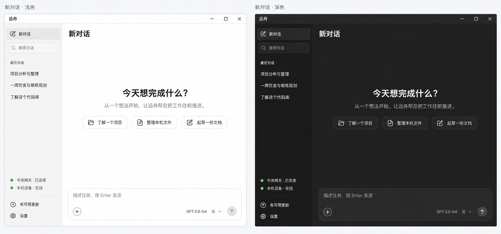
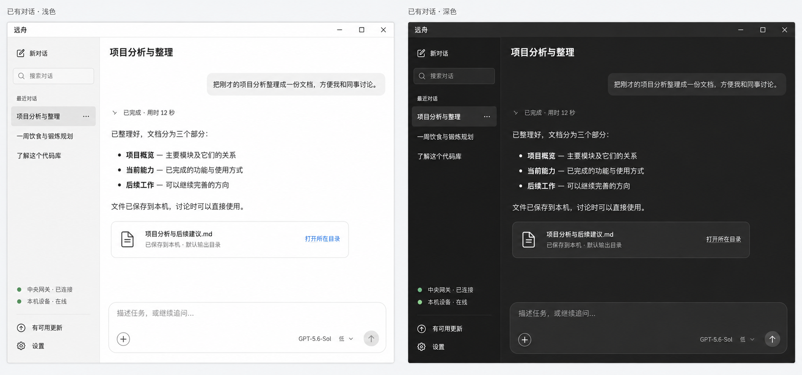
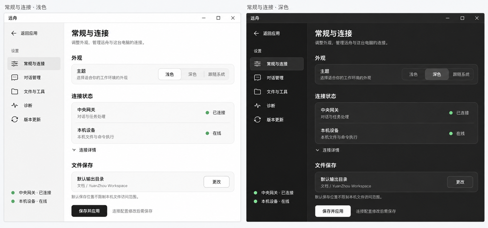
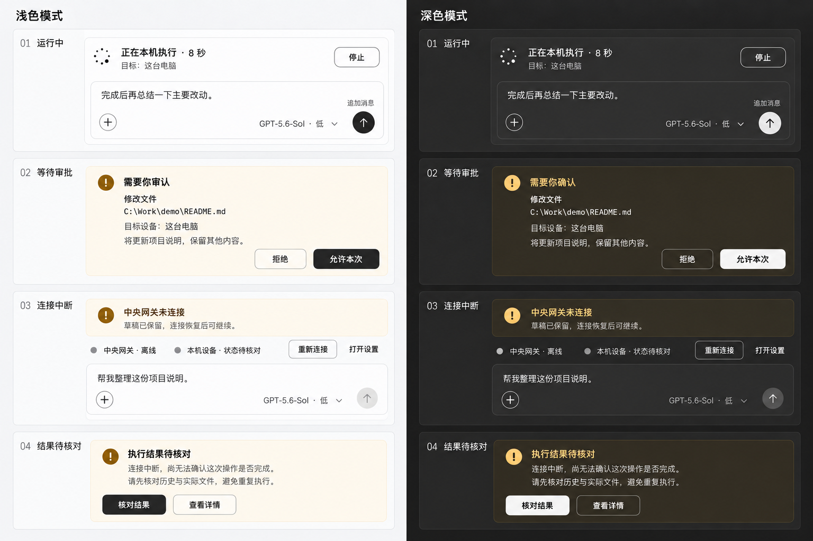

# 远舟客户端 V0.3 视觉设计图

日期：2026-09-20。状态：**第一批视觉参考图，已进入客户端实现阶段**。

后续反馈：用户运行第一版后提供第二张 Codex 页面作为新的展示参考，已按规范顶部「第二张参考图修订」调整客户端。以下生成图作为首轮设计记录保留，布局尺度、气泡色和输入框等有冲突时，以当前规范和实现为准。

依据[客户端 UI 设计规范 V0.3](../../客户端UI设计规范.md)，采用「精致极简的工作工具」方向。图稿阶段按要求只交付图片与文档；随后用户明确「可以开始写代码了」，已在现有客户端实施。实际实现及验证范围见[客户端手册](../../客户端维护手册.md)，未打包或发布。

## 图稿清单

每张图均为左浅色、右深色，同一场景对照。

| 图稿 | 内容 | 实际像素尺寸 |
| --- | --- | --- |
| [01 新对话](01-new-conversation.png) | 侧栏、欢迎语、起步项、底部输入区 | 1832 × 859 |
| [02 已有对话](02-conversation.png) | 用户消息、折叠过程、助手正文、文件结果与输入区 | 1832 × 859 |
| [03 常规与连接](03-general-settings.png) | 设置导航、主题、两类连接状态、默认输出目录、保存操作 | 1832 × 859 |
| [04 关键任务状态](04-task-states.png) | 运行中、等待审批、连接中断、执行结果待核对 | 1536 × 1024 |

生成方式：内置 image_gen，完整输入与生成顺序见[提示词记录](PROMPTS.md)。已有对话图先生成，其余图以它作为风格参考。图内任务、路径、文件、模型和在线状态均为设计示例，不表示当前服务、功能或文件的真实状态。

这些是高保真视觉效果图，不是 Tauri 运行截图、可交互原型或精确像素标注图。生成的字号、色值、图标细节和局部间距可能与规范数值有差异；后续实现以规范中的语义令牌和真实交互条件为准，不能从位图取色或缩放尺寸代替实现验收。图中按钮不构成任何配对、执行或审批授权。

## 评审重点

- 浅色侧栏与白色主区是否协调；深色表面是否层次清楚、适合长时间阅读。
- 侧栏宽度、主内容留白、正文和输入区的比例是否合适。
- 文件结果是否足够紧凑，文件名、保存结果与打开所在目录操作是否易找。
- 设置是否能先看到主题、连接与保存位置，技术细节是否适合收起。
- 运行中停止与追加是否都可见；断线和结果未知能否正确引导恢复。

## 检查与范围

已查看四张生成结果：三张主页面均有深浅配对、同一内容和相近结构；状态图包含四类状态且未把结果未知显示成成功或引导直接重试。已校验 PNG 文件头和实际尺寸、文档链接及 Git 文档差异。图稿未进行真实控件对比度、键盘、缩放、布局或功能验收。

这一批用于确定共同视觉语言，不代表所有页面状态已穷尽。其余设置页沿用统一令牌和组件，在现有客户端中实施；图稿本身不作为控件、状态、键盘及布局验收证据。

## 01 新对话

## 02 已有对话

## 03 常规与连接

## 04 关键任务状态

