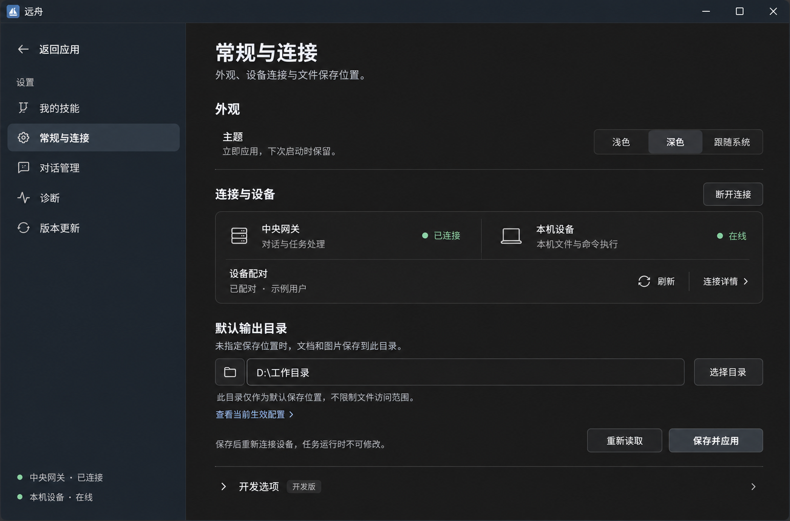
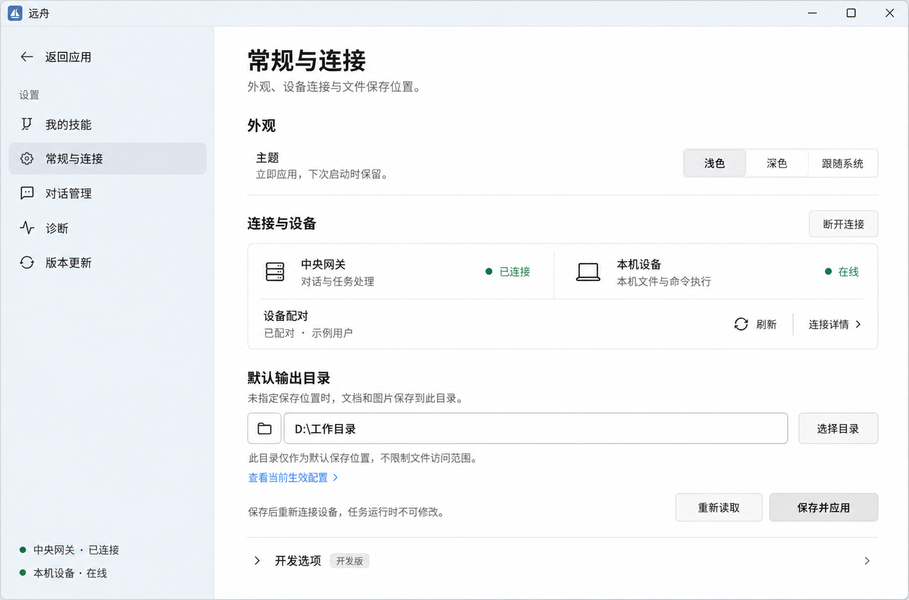

# 常规与连接 · 紧凑重排设计稿

日期：2026-09-22。状态：**用户已确认，开发版已实施，未打包发布**。

依据用户最新页面截图及[客户端 UI 规范](../../客户端UI设计规范.md)的紧凑控件和中性输入焦点规则。保留现有功能，重新组织主区信息；不改中央推理、客户端执行的架构。使用 UI/UX Pro Max 辅助设计、内置 ImageGen 生成图稿，完整输入见 [PROMPTS.md](PROMPTS.md)。

## 图稿

- [深色设计稿](dark.png)
- [浅色设计稿](light.png)

两张图为同一默认场景：中央已连接、本机在线、已配对、开发版。用户和目录为示例，不是实时服务状态。图稿为生成的视觉参考，不是 Tauri 截图或可交互界面；精确按钮尺寸、字体、平面色值和焦点行为以现有规范为准，不从位图缩放反推代码。

## 页面重排

1. 页头保留单标题和一句说明，主区共用内容轴。
2. 外观采用单行设置：主题名称/说明在左，紧凑三段选择在右，取消单行外侧的大卡片。
3. 连接与设备集中到一个轻量分组：上半部并列中央网关和本机设备，两类状态分别展示；下半部显示配对摘要、刷新与连接详情。断开连接紧邻所属分组标题。
4. 默认输出目录独立成组，说明、路径输入、选择目录、生效配置与保存操作靠近，减少跨区寻找。目录只作为默认保存位置，不能表现为文件访问边界。
5. 开发连接模式下移到页底「开发选项」折叠区，仅开发构建显示，正式客户端继续不显示该入口。

## 交互与功能保留映射

| 现有能力 | 设计中的位置/行为 |
| --- | --- |
| 浅色/深色/跟随系统 | 外观右侧，保持即时保存 |
| 网关连接、断开、错误、重试 | 连接分组标题右侧随真实状态变化；不能把设备在线当网关连接 |
| 本机设备状态 | 单独显示在线、离线或恢复中，不由 Agent 进程存在推断 |
| 配对状态、关联用户、刷新 | 连接分组下半部摘要；刷新只读取，不改变配对 |
| 中央地址和设备标识 | 连接详情内，只读；不改为手动地址配置 |
| 取消本机配对 | 连接详情内独立危险操作，保留断开和重新配对说明，不能与断开连接混淆 |
| 首次使用/失效配对 | 分组内展开一体配对码和「配对并连接」；明确错误、读取失败和重试，不要求已配对用户重复输入 |
| 输出目录、目录选择 | 保留现有本机选择器和原路径，输入框使用中性灰焦点 |
| 查看当前生效配置 | 输出目录下的折叠入口，保留实际生效值/覆盖信息 |
| 保存并应用、重新读取配置 | 输出目录底部右侧，保留未保存离开保护、真实应用/读取状态和错误；任务忙碌时仍按原条件禁用 |
| 开发连接模式 | 仅 DEV 分支中下移并折叠；不新增正式客户端本地推理或 Fake Central 入口 |

图稿展示默认在线已配对场景；未配对、授权失效、详情展开及保存失败已按上述映射实现并通过模拟 IPC 回归，实际原生验证范围见验证手册。

## 尺度与响应式

- 普通动作 28px、主要保存操作 32px，按钮圆角 6px；不采用大面积高反差主按钮。图中刷新图标、状态图标实施时使用现有线性 SVG 和 14–16px 控件图标规格。
- 分组间距 16–24px；一般正文 14px，辅助说明/按钮 13px。目录长路径不挤压选择目录按钮。
- 宽屏中央与设备两列，空间不足改为两行；操作区可换行，窄窗口仍能访问保存与详情。按现有 960px 抽屉及 44px 粗指针目标规则适配。
- 点击输入框只有柔和灰边界，Tab 导航保留中性灰焦点提示。
- 生成图可能存在局部阴影、圆角或字号偏差；代码阶段保持规范规定的纯色表面、14px 主区左上圆角和无大阴影风格。

## 本轮交付边界

已目视核对浅深主题、导航、两类连接状态、配对摘要、输出目录和操作内容一致；已核对图像文件与链接。UI/UX Pro Max 的检索中仅采用与桌面工具相符的极简排版建议；渐进披露专项未得到匹配结果，折叠技术细节依据现有仓库规范和页面功能，未采用营销页、金色强调或在线字体建议。

初轮仅交付图稿；用户确认后已整合现有 App、RuntimeSettings、PlatformAccountSettings 和样式，UI 规范及维护手册同步。TypeScript check、Vite build 与配对/目录交互回归通过；浅深主题及窄窗口截图已核对，实际 Windows Tauri 已查看浅色页面。具体证据及未验收范围见[验证手册](../../验证与已知限制.md)。这些图仍是设计参考，不能当作实际运行截图；未改版本、打包发布或部署中央。

