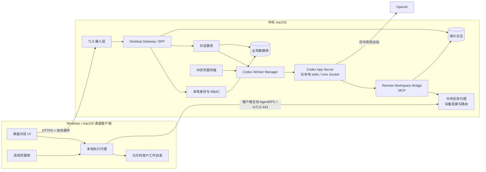
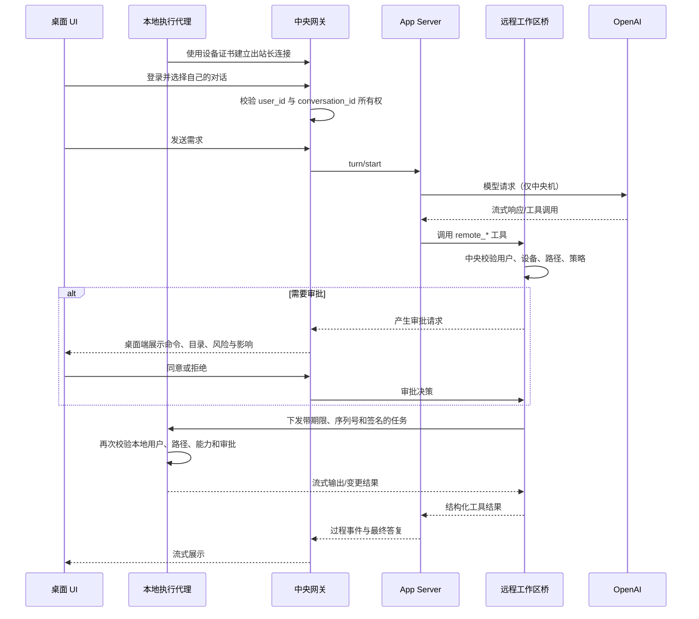
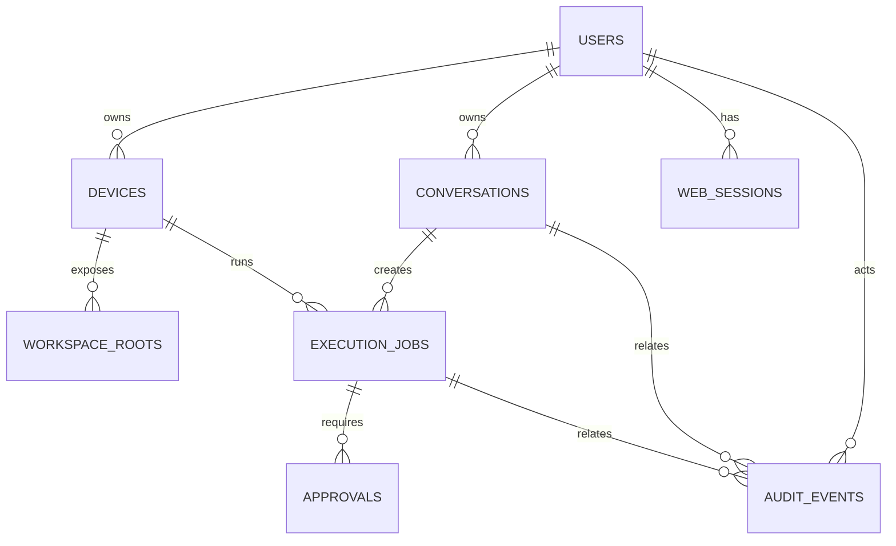
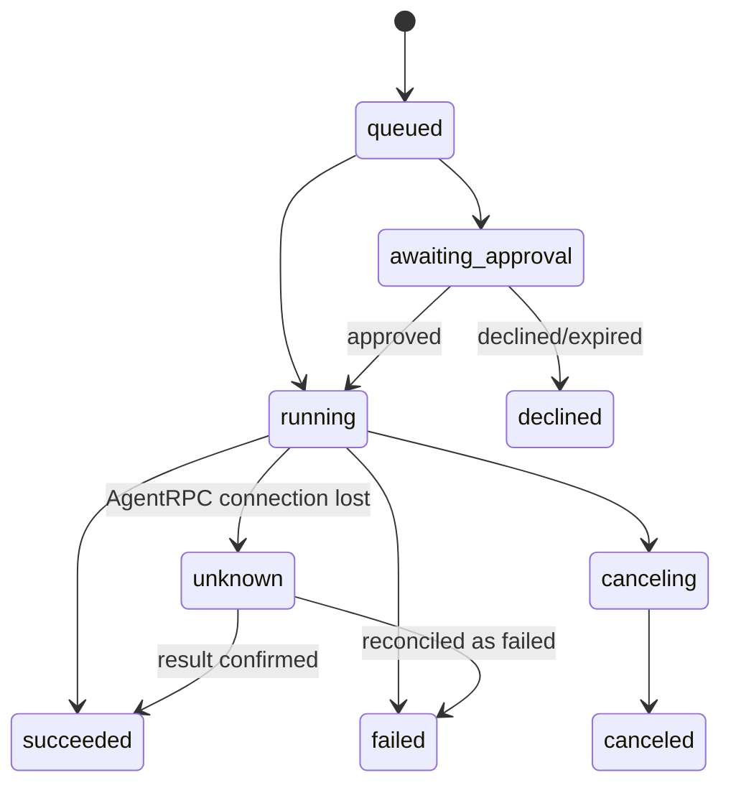

# 中央化 Codex 多用户远程工作平台

> 需求规格与技术架构设计（V0.2）  
> 中央 macOS 单一 OpenAI 出口 / Windows 与 macOS 桌面客户端 / 本地非 GUI 执行

| 文档属性 | 内容 |
|---|---|
| 文档状态 | Draft / 待评审 |
| 版本 | V0.2 |
| 日期 | 2026-08-31 |
| 适用阶段 | 方案评审、原型开发、MVP 实施、验收 |
| 目标读者 | 产品、架构、前端、后端、安全、运维、测试 |
| 需求来源 | 当前需求沟通结论；V0.2 调整为桌面客户端优先架构 |

## 文档版本记录

| 版本 | 主要变化 |
|---|---|
| V0.1 | 采用浏览器 UI，客户端通过系统 SSH/SFTP 接受中央机操作。 |
| V0.2 | 调整为 Windows/macOS 桌面客户端；内置本地执行代理、设备配对、AgentRPC、签名更新；SSH 降级为可选兼容适配器。 |

---

## 1. 执行摘要

本项目要建设一个运行在局域网内的多用户桌面平台。Codex 以及访问 OpenAI 所需的凭据只部署在一台中央 macOS 机器上；Windows 和 macOS 客户端安装自研桌面应用，但不安装 Codex、不持有 ChatGPT/OpenAI 账号或凭据，也不直接向 OpenAI 发起请求。

每位用户拥有独立的平台账号、设备绑定、工作目录和对话空间，可以在桌面应用中创建、切换、搜索、重命名、归档和删除自己的对话。Codex 的推理发生在中央机，但文件读取、文件修改、Git、构建、测试、依赖安装和普通命令执行等工作由桌面应用内置的本地执行代理完成。

推荐方案是开发中央服务和跨平台桌面客户端。中央网关通过本机 `stdio` 或 Unix Socket 驱动 Codex App Server；客户端本地执行代理主动连接中央任务代理，向中央侧 Remote Workspace Bridge 提供受控的文件、命令、Git 和进程能力。用户无需配置系统 OpenSSH Server，也无需开放客户端入站 22 端口。

> **桌面端传输决策：** 主链路推荐使用客户端主动发起的 mTLS WebSocket/HTTP2 双向通道，而不是在客户端暴露 SSH Server。可在通信层保留“嵌入式 SSH/反向 SSH”适配器，作为兼容或故障诊断方案；产品能力不应依赖用户手工配置 SSH。

> **上线阻断项：账号与授权模式必须先确认。**
>
> 技术上可以让所有 OpenAI 通信都从中央机发出，但目前官方资料不能据此证明“一个个人 ChatGPT/Codex 订阅可由多个自然人通过自建网关共同使用”。若作为多人生产服务，优先采用仅保存在中央机的 OpenAI Platform 项目/服务账号 API Key，或企业场景支持的受控访问令牌；API Key 按标准 API 用量计费，不使用 ChatGPT 套餐内额度。若坚持使用个人 ChatGPT 登录，必须先向 OpenAI/合同负责人取得明确授权，再进入生产部署。

---

## 2. 背景与问题定义

### 2.1 当前诉求

- 只有中央 macOS 机器运行 Codex。
- 只有中央机与 OpenAI/ChatGPT 通信。
- 客户端为 Windows 和 macOS。
- 客户端用户没有 ChatGPT/OpenAI 账号。
- 用户通过自研桌面应用完成日常交互，不依赖终端或浏览器。
- 每位用户只能查看和管理自己创建的对话。
- Codex 需要对客户端的文件、代码、命令和进程开展工作。
- SSH、文件传输、命令执行、设备配对和审批等能力应集成在客户端软件中，避免用户手工配置。
- 当前阶段不考虑鼠标、键盘、窗口、截图等 GUI 自动化。

### 2.2 需要解决的核心矛盾

Codex 运行在中央机时，其默认本地命令与文件能力也会作用于中央机；但本项目希望它处理客户端电脑上的工作。因此必须把“模型与对话运行位置”和“实际工作区及命令执行位置”解耦：

1. 中央机负责身份、对话、模型通信、任务调度、全局策略与审计。
2. 桌面客户端负责可视化交互、设备身份、用户现场审批和本地受控执行。
3. 客户端主动连接中央机，中央机不要求客户端开放入站端口。
4. 客户端只与中央机通信，不直接访问 OpenAI，也不接触 OpenAI 凭据。

---

## 3. 建设目标与成功标准

### 3.1 业务目标

1. 提供统一的 Windows/macOS 原生桌面体验。
2. 用一个中央服务管理多位局域网用户，同时保证对话和设备隔离。
3. 让 Codex 在不安装到客户端的前提下，通过内置执行代理处理客户端工作区。
4. 将高风险操作置于明确审批、最小权限和完整审计之下。
5. 将安装、配对、自动更新、日志采集和连接恢复纳入产品能力。
6. 为后续扩展 GUI 自动化、统一身份、配额和多中央节点预留边界。

### 3.2 MVP 成功标准

- Windows 与 macOS 均可安装、配对和登录桌面客户端。
- 用户可以独立管理自己的对话，无法访问他人的对话元数据与内容。
- 用户消息与 Codex 过程事件可流式展示。
- Codex 可以在绑定客户端的允许目录内读取、修改文件并运行命令。
- 写文件、删除、依赖安装、长时间进程和其他高风险动作可触发审批。
- 普通用户不需要安装、启用或配置 OpenSSH Server，也不需要开放入站端口。
- OpenAI 凭据只存在于中央机，客户端抓包与进程环境中均不可发现。
- 客户端到 OpenAI 的直接出站流量可被防火墙阻断而不影响平台使用。
- 所有登录、对话管理、远程执行、审批和管理动作均有可追溯审计记录。

### 3.3 暂不承诺的指标

以下参数需在试点前确认，不应由开发团队自行假设：

- 注册用户数、同时在线人数、并发任务数。
- 单任务最长运行时间、最大输出量、最大文件大小。
- 对话与审计日志保留时长。
- 可用性目标、恢复时间目标（RTO）与恢复点目标（RPO）。
- 每用户或全局 OpenAI 用量和费用上限。

---

## 4. 范围

### 4.1 V1/MVP 范围内

- Windows/macOS 跨平台桌面客户端。
- 客户端安装、首次配对、设备证书、自动登录和安全更新。
- 客户端主动建立到中央机的加密双向通道。
- 本地用户账号、登录、注销、密码管理和会话管理。
- 用户与客户端设备的一对一或一对多绑定。
- 对话的新建、继续、切换、搜索、重命名、置顶、归档、恢复和删除。
- Codex 回复、计划、命令输出、文件变更和审批请求的流式展示。
- Windows/macOS 客户端在线状态、版本、能力和通道健康检查。
- 受允许目录限制的文件浏览、读取、创建、修改、移动和删除。
- 普通命令、PowerShell/zsh、Git、构建、测试、依赖安装。
- 后台进程启动、状态查询、输出查看和停止。
- 操作审批、超时、取消、重试和审计。
- 中央机单节点部署、备份和恢复。
- 可选的嵌入式 SSH/系统 SSH 兼容适配器，但不是默认传输。

### 4.2 V1/MVP 范围外

- 鼠标、键盘、窗口、桌面截图和 GUI 自动化。
- 客户端直接登录或连接 ChatGPT/OpenAI。
- 客户端直接连接 Codex App Server。
- 从公网直接访问；远程办公可后续通过 VPN/零信任网络接入。
- 浏览器版终端用户 UI、手机原生应用。
- 多中央节点、高可用集群和自动故障转移。
- 默认使用管理员/root 权限执行命令。
- 任意磁盘根目录访问。
- 用户之间共享对话或协作编辑；可作为后续版本能力。

---

## 5. 术语

| 术语 | 定义 |
|---|---|
| 中央机 | 唯一运行 Codex 并访问 OpenAI 的 macOS 主机。 |
| 桌面客户端 | 安装在 Windows 或 macOS 上的自研应用，承载对话 UI、设备身份、审批和本地执行。 |
| 本地执行代理 | 桌面客户端的受控后台组件，使用当前操作系统用户权限处理文件、命令、Git 和进程。 |
| 中央任务代理 | 中央机上维护客户端连接、路由任务、确认设备身份并转发事件的服务。 |
| 平台用户 | 由中央平台创建的本地账号，与 ChatGPT/OpenAI 账号无关。 |
| 对话 | 用户与 Codex 的一个独立上下文，对应 App Server Thread。 |
| 回合 | 用户的一次请求及其后续代理工作，对应 App Server Turn。 |
| 远程工作区 | 某用户设备上被允许访问的一组目录。 |
| 工作区桥接服务 | 运行在中央机，将 Codex 工具调用转换为发往目标桌面客户端的受控任务。 |
| AgentRPC | 本文对客户端主动建立的 mTLS WebSocket/HTTP2 双向任务协议的统称，不是 OpenAI 官方协议。 |
| 审批 | 对写入、删除、命令或网络等敏感操作进行的人机确认。 |
| 租户隔离 | 确保一个平台用户不能读取、修改或推断另一用户的数据与任务。 |

---

## 6. 已确认约束与设计原则

### 6.1 强制约束

1. OpenAI 凭据不得下发到客户端或浏览器。
2. 桌面客户端不得直接连接 Codex App Server。
3. App Server 仅监听中央机本地 `stdio` 或 Unix Socket。
4. 客户端只安装自研桌面应用；不安装 Codex，不要求系统 SSH 服务。
5. 所有远程工具调用必须先完成用户、设备、工作目录和权限校验。
6. 每个对话必须有明确且不可篡改的所有者。
7. 所有客户端系统操作默认使用当前登录的普通系统用户权限。
8. GUI 自动化能力在 V1 中明确禁用，而不是“未展示但可调用”。
9. 客户端主动连接中央机，默认不监听局域网入站端口。
10. 桌面客户端必须代码签名，并具备可验证、可回滚的安全更新机制。

### 6.2 设计原则

- **中央凭据、端侧执行：** 模型凭据集中保管，任务在用户设备执行。
- **出站连接优先：** 客户端主动连接中央机，减少防火墙配置和暴露面。
- **默认拒绝：** 未绑定设备、未授权路径、未知工具和越权对话均拒绝。
- **后端裁决：** 权限检查只在服务端完成，不能依赖前端隐藏按钮。
- **双端裁决：** 中央端决定租户、设备和策略，客户端再次校验路径、能力和本地授权。
- **强类型工具：** 通过结构化远程工具代替让模型任意拼接远程命令。
- **可审批、可取消、可审计：** 任何副作用动作必须有生命周期记录。
- **最小权限：** 先满足普通用户目录与开发任务，不默认提供提权。
- **租户信息不进入提示词：** 用户边界必须由代码和数据权限保证，不能依赖提示词约束。

---

## 7. 总体架构

### 7.1 逻辑架构



### 7.2 关键数据流



### 7.3 为什么选用 App Server

Codex App Server面向深度集成的富客户端，官方提供身份、对话历史、审批和代理事件流等协议能力，并支持创建、读取、列出、归档、恢复和删除 Thread。平台可以复用这些核心能力，同时由自建网关补充本地多用户身份、设备映射和强租户隔离。

App Server 的 WebSocket 传输目前被官方标记为实验性且不支持生产，因此 V1 不把它直接暴露到局域网。中央网关应作为 App Server 的唯一客户端，并通过默认 `stdio` 或本地 Unix Socket 建立连接。桌面客户端与中央网关之间使用平台自有、可版本化的稳定 API，不透传 App Server JSON-RPC。

### 7.4 客户端传输方案比较

| 方案 | 优点 | 主要问题 | 结论 |
|---|---|---|---|
| 系统 OpenSSH Server | 标准协议、PoC 快 | 需要逐机启用服务、开放 22 端口、配置账号/Key/防火墙 | 仅保留为 PoC 或故障诊断后备方案 |
| 客户端内嵌 SSH Server | 用户无需单独安装 SSH；可复用 SSH/SFTP 库 | 仍需监听入站端口；扩大攻击面；审批与任务状态需额外协议 | 不作为默认生产方案 |
| 内嵌 SSH + 反向隧道 | 无客户端入站端口；SSH 能力完整 | 双层 SSH 状态复杂；断线、复用、升级和审计成本较高 | 可作为 AgentRPC 的可插拔适配器 |
| 客户端主动 AgentRPC | 无入站端口；最适合强类型工具、审批、流式事件和版本协商 | 需要自研协议与客户端代理 | **推荐主方案** |

AgentRPC 不需要实现通用远程 Shell 登录。它只开放产品明确支持的文件、命令、Git 和进程操作，权限面比完整 SSH Server 更小。若确需兼容 SSH，通信层应通过统一 `ClientTransport` 接口接入，不能让上层业务依赖 SSH 特性。

---

## 8. 组件职责

### 8.1 TLS 接入层

- 终止 TLS，只开放局域网 `443/tcp`。
- 为桌面 API、事件流和 AgentRPC 提供统一入口。
- 将长连接代理至中央任务代理，而不是 App Server。
- 可选实现 IP 白名单、访问频控和管理端独立入口。

推荐候选：Caddy 或 Nginx。局域网证书可由内部 CA 签发，并分发根证书到受管设备。

### 8.2 桌面客户端

- 提供登录、对话、消息、任务、diff 和审批 UI。
- 保存中央机地址、设备证书和非敏感偏好；不保存 OpenAI 凭据。
- 启动并监督本地执行代理，展示代理在线状态、版本与权限。
- 处理应用深链、通知、断线重连、自动更新和崩溃报告。
- Windows 包使用代码签名的 MSIX/MSI；macOS 包完成 Developer ID 签名和公证。
- 自动更新包必须校验发布签名，失败时保留上一可用版本并停止安装。

桌面 UI 与本地执行代理建议分进程：UI 被渲染内容攻击时，不应直接获得任意命令执行能力。两者通过仅本机可访问、带进程身份校验的 IPC 通信。

### 8.3 Desktop Gateway / BFF

- 提供桌面客户端所需的 HTTPS API 和事件流。
- 管理登录令牌、设备绑定、请求限流和输入校验。
- 对每个对话请求执行所有权校验。
- 把 App Server 协议转换为前端稳定的数据模型。
- 处理断线重连、事件游标、幂等键、任务取消和错误映射。
- 写入审计日志，不记录明文凭据和不必要的敏感文件内容。

### 8.4 本地身份、设备身份与 RBAC

- 平台账号由管理员创建，和 OpenAI 身份完全隔离。
- 支持用户、管理员、审计员三类角色。
- 使用 Argon2id 等现代算法存储密码摘要。
- 用户登录令牌存入系统凭据库；短期 Access Token 与可撤销 Refresh Token 分离。
- 设备使用独立密钥对和设备证书，不与用户密码混用。
- 支持会话失效、密码重置、连续失败锁定和可选 TOTP MFA。
- 用户停用、设备解绑或证书吊销后，现有长连接立即失效。

### 8.5 对话服务

- 维护 `platform_user_id <-> app_server_thread_id` 的唯一映射。
- 业务数据库是对话所有权的权威来源。
- App Server 返回的 Thread ID 视为不可信输入；任何读写前再次鉴权。
- 不允许桌面客户端自行指定用户 ID、他人设备 ID 或 App Server 数据目录。
- 支持标题、置顶、归档状态、创建时间、最近活动时间和搜索索引。

### 8.6 Codex Worker Manager

建议按用户启动隔离的 App Server Worker，而不是让所有用户直接共享一个无边界进程：

- 每个活跃用户拥有独立的 Codex 状态目录和进程权限边界。
- Worker 只由网关启动、监控、回收和重启。
- OpenAI 凭据由中央凭据存储注入，不复制到桌面客户端。
- 每个 Worker 只挂载该用户的远程工作区桥配置。
- 空闲 Worker 可停止；对话状态持久化后可恢复。

> 若所选认证方式无法安全支持按用户 Worker 隔离，MVP 可先使用单 App Server 进程，但必须保留网关所有权映射、逐请求鉴权和隔离测试；生产前应完成专项威胁评审。

### 8.7 Remote Workspace Bridge

- 在中央机运行，以 MCP STDIO 服务方式接入 Codex。
- 根据当前已认证平台用户解析其设备和允许工作区。
- 将强类型任务发送给中央任务代理，不直接向客户端发起任意网络连接。
- 对路径进行规范化后再做允许目录校验，阻断 `..`、符号链接逃逸和盘符绕过。
- 不允许模型传入任意主机、端口、设备证书或本地 IPC 地址。
- 提供命令超时、输出上限、进程隔离、取消和审计。
- 返回结构化错误，例如 `CLIENT_OFFLINE`、`PATH_DENIED`、`APPROVAL_REQUIRED`。

### 8.8 中央任务代理

- 接受桌面客户端主动建立的长连接，并验证设备证书、用户状态和客户端版本。
- 为每台设备维护单一逻辑会话、心跳、能力清单和任务队列。
- 将桥接任务路由到正确设备，不允许客户端订阅其他设备的队列。
- 支持流式输出、断点续传、取消、超时、背压和消息幂等。
- 拒绝过期、重复、乱序、签名无效或设备不匹配的任务。
- 兼容传输适配器可实现 AgentRPC、反向 SSH 或系统 SSH，但上层任务契约保持一致。

### 8.9 本地执行代理

- 作为当前系统用户的每用户进程运行，不默认安装为 SYSTEM/root 服务。
- 使用本地原生文件和进程 API，执行前重新校验规范化路径与工作区授权。
- 维护子进程树，支持标准输入输出流、超时、取消和重启后的状态核对。
- 将用户批准与操作绑定到 `operation_id`、请求摘要、设备和有效期。
- 只接受中央任务代理签发且属于本设备的任务。
- V1 不包含屏幕读取、鼠标、键盘和窗口控制模块。

### 8.10 数据库与审计

- MVP 可使用 SQLite 快速验证；多人长期运行优先 PostgreSQL。
- 业务库保存本地用户、设备、对话所有权、任务、审批和配置。
- App Server 自身会话数据与平台元数据分别备份。
- 审计日志采用追加写语义；高风险环境可写入远程日志系统或 WORM 存储。

---

## 9. 用户、角色与权限模型

### 9.1 角色

| 角色 | 权限 |
|---|---|
| 普通用户 | 使用桌面客户端管理自己的对话；访问本机允许目录；审批自己的任务。 |
| 管理员 | 创建/停用用户；绑定设备；配置目录、密钥、配额和策略；查看系统状态。默认不能直接查看用户对话内容。 |
| 审计员 | 只读查看审计元数据和安全事件；是否可查看命令全文需单独授权。 |

### 9.2 所有权规则

1. 一个对话只有一个所有者，V1 不共享。
2. 一个设备安装实例绑定一个平台用户和一个操作系统用户；同一物理机多人使用时，每个 OS 用户拥有独立客户端配置、证书和目录映射。
3. 每个远程任务继承对话所有者，不接受前端提交的替代用户 ID。
4. 管理员操作必须走独立管理 API，并产生审计记录。
5. 对无权访问的对象统一返回 `404`，避免泄露对象是否存在。

### 9.3 设备配对与本地账号建议

- 用户先在桌面客户端登录平台账号，再使用一次性配对码注册当前设备。
- 客户端在本机生成不可导出的设备密钥对；私钥存入 Windows Credential Manager/DPAPI 或 macOS Keychain。
- 中央机签发短期或可轮换的设备证书，并将其与用户、设备指纹和安装实例绑定。
- 本地执行代理只以当前登录的普通 OS 用户身份运行；文件访问自然受该用户 ACL 约束。
- 如需多人共用一台物理机，每人使用自己的 OS 账号，客户端状态不能写入全机共享目录。
- 管理员可在中央端吊销设备；客户端重装或设备密钥丢失后必须重新配对。
- SSH Key 只在启用 SSH 兼容适配器时生成，且同样按设备独立、可吊销。

---

## 10. 核心用户流程

### 10.1 安装、配对与登录

1. 用户从受信任内网地址下载安装包，并验证发布者签名。
2. 用户启动桌面客户端，输入中央机地址并使用平台本地账号登录。
3. 首次登录使用一次性配对码注册设备，客户端在本机生成设备密钥。
4. 中央机批准后签发设备证书，客户端建立出站长连接。
5. 首页显示当前设备、代理状态、客户端版本和自己的最近对话。
6. 用户从系统目录选择器中授权工作区；中央策略可进一步缩小范围。

### 10.2 新建并继续对话

1. 用户点击“新建对话”。
2. 选择当前绑定设备和已授权工作区。
3. 网关创建业务对话记录，再调用 App Server 创建 Thread。
4. 映射持久化成功后才向用户返回对话。
5. 用户再次打开时，网关校验所有权并恢复 Thread。

### 10.3 远程执行

1. Codex 产生远程工具调用。
2. 桥接服务从服务端上下文获取用户、设备和根目录，完成中央策略校验。
3. 中央任务代理将任务发往该设备的出站长连接。
4. 若需要审批，则暂停任务并在桌面客户端展示可读摘要。
5. 用户在桌面端批准后，本地执行代理再次校验任务摘要、路径和权限。
6. 拒绝或超时则向 Codex 返回结构化结果；批准后在本机执行。
7. 输出分块写入任务事件流并显示在桌面对话中。

### 10.4 客户端离线

- 新任务立即返回“设备离线”，不得悄悄改在中央机执行。
- 已运行任务连接中断时标记为“状态未知”或“已失败”，不能误报成功。
- 用户可在设备恢复后手动重试；写操作默认不自动重放。
- 客户端恢复连接时先完成版本、证书和任务游标协商，再接收新任务。

### 10.5 桌面端信息架构

```text
┌────────────────────────────────────────────────────────────────────┐
│ 账号 / 当前设备 / 连接状态 / 客户端版本 / 更新提示                 │
├───────────────┬──────────────────────────────┬─────────────────────┤
│ 对话导航      │ 对话与流式过程               │ 任务与上下文        │
│ - 新建        │ - 用户消息                   │ - 当前工作区        │
│ - 搜索        │ - Codex 回复                 │ - 文件变更 / diff   │
│ - 置顶        │ - 计划与进度                 │ - 命令与输出        │
│ - 归档        │ - 工具调用卡片               │ - 待审批操作        │
│ - 删除        │ - 错误与重试                 │ - 后台进程          │
├───────────────┴──────────────────────────────┴─────────────────────┤
│ 输入框 / 发送 / 停止任务 / 选择工作区                              │
└────────────────────────────────────────────────────────────────────┘
```

设计要求：

- 用户不需要看到或输入 SSH 命令、主机、端口和 Key。
- 普通命令输出以可折叠任务卡展示，并提供复制、搜索和截断提示，不要求用户打开终端。
- 文件改动以 diff 为主要审核形式，危险操作使用独立审批弹窗和系统通知。
- 连接状态必须区分“中央机不可达”“设备证书失效”“本地代理异常”“客户端版本过低”。
- 设置页至少包含账号、设备、工作区、审批偏好、更新和诊断六个区域。

---

## 11. 功能需求

优先级定义：`P0` 为 MVP 必须，`P1` 为首个稳定版本建议，`P2` 为后续增强。

### 11.1 身份与会话

| ID | 优先级 | 需求 | 验收要点 |
|---|---:|---|---|
| AUTH-001 | P0 | 管理员创建、停用和重置平台用户。 | 停用后所有既有会话立即失效。 |
| AUTH-002 | P0 | 用户使用平台账号登录，不需要 OpenAI 账号。 | 客户端无 OpenAI 登录流程和凭据。 |
| AUTH-003 | P0 | 登录态使用短期 Access Token 和可撤销 Refresh Token。 | Refresh Token 仅存系统凭据库；日志中不出现明文。 |
| AUTH-004 | P0 | 防暴力破解与会话固定攻击。 | 连续失败触发限流/锁定；登录后轮换会话 ID。 |
| AUTH-005 | P1 | 支持 TOTP MFA。 | 管理员可要求特定角色启用 MFA。 |

### 11.2 桌面客户端生命周期

| ID | 优先级 | 需求 | 验收要点 |
|---|---:|---|---|
| APP-001 | P0 | 提供签名的 Windows 和 macOS 安装包。 | 系统显示可信发布者；被篡改安装包无法运行。 |
| APP-002 | P0 | 支持一次性配对码注册设备。 | 配对码短期有效、单次使用并绑定当前用户。 |
| APP-003 | P0 | 设备私钥存入系统凭据库且不可通过 UI 导出。 | 普通日志和配置文件不含私钥。 |
| APP-004 | P0 | 客户端主动建立并恢复加密长连接。 | 不开放入站端口；网络短暂中断后自动重连。 |
| APP-005 | P0 | UI 与本地执行代理进程隔离。 | UI 渲染层不能直接启动任意进程或读取任意文件。 |
| APP-006 | P0 | 支持签名校验的自动更新与回滚。 | 更新失败时保留上一版本；服务端可设置最低安全版本。 |
| APP-007 | P1 | 提供托盘状态、任务通知和诊断包导出。 | 诊断包默认脱敏且不含对话正文和凭据。 |

### 11.3 对话管理

| ID | 优先级 | 需求 | 验收要点 |
|---|---:|---|---|
| CONV-001 | P0 | 新建、继续和切换对话。 | 刷新或重启中央服务后仍可继续。 |
| CONV-002 | P0 | 仅列出当前用户的对话。 | 修改请求中的 Thread ID 不能访问他人对话。 |
| CONV-003 | P0 | 重命名、归档、恢复和永久删除。 | 删除前二次确认；删除动作审计。 |
| CONV-004 | P1 | 标题搜索、置顶和按最近活动排序。 | 搜索结果不跨用户。 |
| CONV-005 | P0 | 流式显示回复和工具过程事件。 | 断线重连后可从事件游标继续，不重复渲染。 |
| CONV-006 | P0 | 支持停止当前回合。 | 停止后不再发起新的远程副作用操作。 |
| CONV-007 | P1 | 显示模型、设备、工作区和任务状态。 | 用户能确认当前操作目标。 |

### 11.4 设备与工作区

| ID | 优先级 | 需求 | 验收要点 |
|---|---:|---|---|
| DEV-001 | P0 | 用户配对、管理员批准 Windows/macOS 设备。 | 绑定包含用户、设备证书、安装实例、OS 和能力清单。 |
| DEV-002 | P0 | 显示设备在线/离线/异常状态。 | 不执行具有副作用的“探测命令”。 |
| DEV-003 | P0 | 为设备设置一个或多个允许根目录。 | 根目录外的路径在中央端和客户端均被拒绝。 |
| DEV-004 | P0 | 支持设备证书轮换、吊销和最低客户端版本。 | 吊销或低于安全版本的客户端无法接收任务。 |
| DEV-005 | P0 | 上报版本、OS、Shell、能力和心跳。 | 能力变化不会自动扩大权限。 |
| DEV-006 | P1 | 可选启用 SSH 兼容适配器。 | 默认关闭；启用、密钥轮换和访问均有审计。 |

### 11.5 文件与命令

| ID | 优先级 | 需求 | 验收要点 |
|---|---:|---|---|
| FILE-001 | P0 | 列出目录、读取文本文件和读取元数据。 | 受根目录和大小限制。 |
| FILE-002 | P0 | 创建、修改、移动和删除文件。 | 展示目标路径和变更摘要，按策略审批。 |
| FILE-003 | P0 | 支持补丁式修改并返回 diff。 | 用户可在批准前查看变更。 |
| FILE-004 | P1 | 二进制文件仅允许受限上传/下载。 | 类型、大小和路径均校验。 |
| EXEC-001 | P0 | 执行普通命令并流式返回 stdout/stderr。 | 命令包含 cwd、超时、退出码和截断标记。 |
| EXEC-002 | P0 | 支持 Windows PowerShell 和 macOS 默认 Shell。 | 同一抽象工具在两端返回统一结构。 |
| EXEC-003 | P0 | 支持 Git、构建、测试和依赖安装。 | 依赖安装默认需要审批。 |
| EXEC-004 | P0 | 支持取消前台命令。 | 进程及已知子进程被终止，状态可审计。 |
| PROC-001 | P1 | 启动、查看和停止后台进程。 | 使用平台生成的 process_id，而不是裸 PID 作为唯一标识。 |

### 11.6 审批与审计

| ID | 优先级 | 需求 | 验收要点 |
|---|---:|---|---|
| APR-001 | P0 | 对写入、删除、安装、网络和长任务按策略审批。 | 审批界面展示命令、目录、风险、影响和来源对话。 |
| APR-002 | P0 | 支持批准一次、拒绝、取消和超时。 | 超时默认拒绝。 |
| APR-003 | P1 | 支持仅本回合/本会话授权。 | 不提供跨用户或无限期静默授权。 |
| APR-004 | P0 | 永久删除、提权和高危命令不可被普通“会话批准”覆盖。 | 每次均要求单独确认或由策略拒绝。 |
| AUD-001 | P0 | 记录登录、对话管理、远程任务、审批和管理动作。 | 可按用户、设备、对话、任务和时间检索。 |
| AUD-002 | P0 | 审计记录包含关联 ID 和结果。 | 能从一次用户请求追踪到客户端本地执行。 |
| AUD-003 | P1 | 审计日志防篡改和定期归档。 | 普通管理员不能静默修改历史记录。 |

### 11.7 管理与运维

| ID | 优先级 | 需求 | 验收要点 |
|---|---:|---|---|
| ADM-001 | P0 | 管理员查看服务、Worker、设备和队列状态。 | 不默认展示用户对话正文。 |
| ADM-002 | P0 | 配置全局及用户级并发、超时、文件大小和输出上限。 | 修改有审计记录。 |
| ADM-003 | P1 | 配置模型与费用/用量限制。 | 达到限制时新任务被明确拒绝。 |
| ADM-004 | P0 | 提供备份、恢复和密钥轮换操作手册。 | 在测试环境完成恢复演练。 |
| ADM-005 | P0 | 管理客户端最低版本、更新通道和证书吊销列表。 | 高危旧版本可被中央端阻断。 |

---

## 12. 远程工具契约建议

模型不得直接指定网络主机、用户身份、设备证书或传输参数。下列工具的 `user_id`、`device_id` 和允许根目录均由服务端会话注入，并在客户端再次校验。

### 12.1 建议工具集合

| 工具 | 典型参数 | 是否有副作用 | 默认审批 |
|---|---|---:|---|
| `remote_list_dir` | `path`, `depth`, `limit` | 否 | 自动 |
| `remote_stat` | `path` | 否 | 自动 |
| `remote_read_file` | `path`, `offset`, `limit` | 否 | 自动；敏感路径策略可提升 |
| `remote_search` | `root`, `query`, `globs`, `limit` | 否 | 自动 |
| `remote_apply_patch` | `path`, `patch`, `expected_hash` | 是 | 提示/写操作策略 |
| `remote_write_file` | `path`, `content`, `expected_hash` | 是 | 提示/写操作策略 |
| `remote_move` | `source`, `destination` | 是 | 提示 |
| `remote_delete` | `path`, `recursive` | 是/破坏性 | 每次批准 |
| `remote_exec` | `argv` 或 `script`, `cwd`, `timeout` | 可能 | 按策略；安装/网络/高危必审 |
| `remote_process_start` | `argv`, `cwd`, `env_allowlist` | 是 | 提示 |
| `remote_process_status` | `process_id` | 否 | 自动 |
| `remote_process_stop` | `process_id`, `signal` | 是 | 提示 |

### 12.2 统一返回结构

```json
{
  "ok": true,
  "operation_id": "op_...",
  "device_id": "dev_...",
  "cwd": "/resolved/working/directory",
  "exit_code": 0,
  "stdout": "...",
  "stderr": "...",
  "truncated": false,
  "started_at": "2026-08-31T12:00:00Z",
  "finished_at": "2026-08-31T12:00:03Z"
}
```

失败时使用稳定错误码：

- `CLIENT_OFFLINE`
- `DEVICE_CERT_INVALID`
- `CLIENT_VERSION_BLOCKED`
- `CHANNEL_AUTH_FAILED`
- `CHANNEL_DISCONNECTED`
- `PATH_DENIED`
- `PATH_CHANGED`
- `APPROVAL_REQUIRED`
- `APPROVAL_DECLINED`
- `OPERATION_TIMEOUT`
- `OUTPUT_LIMIT_EXCEEDED`
- `PROCESS_NOT_FOUND`
- `POLICY_DENIED`

### 12.3 命令输入规则

- 优先传递参数数组 `argv`，避免字符串拼接产生 Shell 注入。
- 必须使用 Shell 脚本时，显式声明 `shell=powershell|zsh`，并整体作为标准输入传输。
- 环境变量只允许白名单键；禁止继承中央机的凭据环境变量。
- `cwd` 必须是已解析的绝对路径，且位于允许根目录内。
- 默认禁止 `sudo`、`runas`、修改 SSH 配置、防火墙和系统账号。
- 命令输出必须有字节数限制，并标注是否截断。
- 写文件使用 `expected_hash` 做乐观并发控制，避免覆盖用户刚刚修改的内容。
- 每个任务携带 `operation_id`、设备 ID、签发时间、过期时间、单调序列号和请求摘要；客户端拒绝过期或重放任务。

---

## 13. 审批策略

### 13.1 风险分级

| 等级 | 示例 | 默认处理 |
|---|---|---|
| R0 只读 | 列目录、读普通代码、Git status | 自动允许 |
| R1 可恢复写入 | 修改工作区文件、创建新文件 | 展示 diff 后批准；可允许本回合 |
| R2 外部/长时副作用 | 安装依赖、启动服务、访问网络、Git push | 每次或本回合批准 |
| R3 破坏性/敏感 | 递归删除、覆盖大量文件、凭据目录、提权 | 每次明确批准，部分场景直接拒绝 |

### 13.2 审批界面必须展示

- 发起用户、对话、设备和工作区。
- 工具名称与人类可读动作摘要。
- 完整命令或规范化后的目标路径。
- 预计影响、风险等级、是否访问网络。
- 文件变更 diff 或删除清单摘要。
- “批准一次”“拒绝”“取消”按钮；会话级授权仅在策略允许时出现。

### 13.3 与 Codex 审批能力的关系

App Server 会将命令执行和文件变更审批作为服务端请求发送给客户端；MCP 也支持 `auto`、`prompt`、`writes` 和 `approve` 等工具审批模式。平台应复用这些协议事件，但最终还要在 Remote Workspace Bridge 再执行一次不可绕过的策略校验，形成双层防线。

---

## 14. 数据模型



### 14.1 主要实体

| 实体 | 关键字段 |
|---|---|
| `users` | `id`, `username`, `password_hash`, `role`, `status`, `created_at`, `last_login_at` |
| `web_sessions` | `id_hash`, `user_id`, `expires_at`, `revoked_at`, `ip`, `user_agent` |
| `devices` | `id`, `owner_user_id`, `name`, `os_type`, `install_id`, `agent_version`, `certificate_id`, `status`, `last_seen_at`, `capabilities` |
| `workspace_roots` | `id`, `device_id`, `display_name`, `canonical_path`, `read_only`, `policy_id` |
| `conversations` | `id`, `owner_user_id`, `app_thread_id`, `device_id`, `workspace_root_id`, `title`, `status`, `pinned`, `created_at`, `updated_at` |
| `execution_jobs` | `id`, `conversation_id`, `device_id`, `tool`, `risk_level`, `state`, `request_hash`, `started_at`, `finished_at`, `result_code` |
| `approvals` | `id`, `job_id`, `requested_at`, `expires_at`, `decision`, `decided_by`, `decided_at`, `scope` |
| `audit_events` | `id`, `timestamp`, `actor_user_id`, `action`, `object_type`, `object_id`, `correlation_id`, `result`, `metadata_redacted` |
| `device_certificates` | `id`, `device_id`, `public_key_fingerprint`, `serial`, `issued_at`, `expires_at`, `revoked_at` |
| `transport_credentials` | `id`, `device_id`, `transport_type`, `secret_ref`, `fingerprint`, `rotated_at`, `revoked_at` |

### 14.2 数据约束

- `conversations.app_thread_id` 唯一且不可由普通用户修改。
- 所有业务查询必须包含服务端确定的 `owner_user_id`。
- 设备私钥只存在客户端系统凭据库；中央机只保存设备公钥/证书和吊销状态。
- 仅 SSH 兼容适配器需要的中央私钥不存入普通业务表，只保存密钥管理器引用。
- 审计元数据必须脱敏：不记录密码、Token、私钥、完整环境变量。
- 对话正文的保留与备份策略应与所选 OpenAI 认证/数据策略一起评审。

---

## 15. 桌面 API 与 AgentRPC 草案

桌面 API 前缀：`/api/v1`。所有写请求要求幂等键、短期访问令牌和设备上下文；所有对象权限均由后端校验。

### 15.1 身份

```text
POST   /auth/login
POST   /auth/refresh
POST   /auth/logout
GET    /auth/me
POST   /auth/password/change
```

### 15.2 对话

```text
GET    /conversations?cursor=&query=&archived=
POST   /conversations
GET    /conversations/{id}
PATCH  /conversations/{id}
POST   /conversations/{id}/archive
POST   /conversations/{id}/unarchive
DELETE /conversations/{id}
POST   /conversations/{id}/turns
POST   /conversations/{id}/turns/{turnId}/cancel
GET    /conversations/{id}/events?after={cursor}
```

对话列表绝不能将桌面客户端传入的 `user_id` 作为过滤依据；用户范围来自服务端认证上下文。

### 15.3 设备与工作区

```text
GET    /devices
GET    /devices/{id}/status
GET    /devices/{id}/workspaces
POST   /devices/pairing-codes/redeem
POST   /devices/{id}/certificate/rotate
POST   /devices/{id}/workspaces
DELETE /devices/{id}/workspaces/{workspaceId}
POST   /admin/devices
PATCH  /admin/devices/{id}
POST   /admin/devices/{id}/approve
POST   /admin/devices/{id}/revoke
POST   /admin/client-releases/{version}/minimum
```

### 15.4 审批与任务

```text
GET    /approvals?state=pending
GET    /approvals/{id}
POST   /approvals/{id}/decision
GET    /jobs/{id}
POST   /jobs/{id}/cancel
GET    /jobs/{id}/events?after={cursor}
```

### 15.5 桌面事件流

桌面 UI 可使用 SSE 接收对话事件，或复用平台自有的安全 WebSocket/HTTP2 通道；提交动作仍走 HTTPS API。无论选择哪种方式，都与 App Server 的实验性 WebSocket 无关，不能透传 App Server 协议。

每个事件至少包含：

```json
{
  "event_id": "evt_...",
  "correlation_id": "corr_...",
  "conversation_id": "conv_...",
  "turn_id": "turn_...",
  "type": "agent_message_delta",
  "sequence": 42,
  "created_at": "2026-08-31T12:00:00Z",
  "payload": {}
}
```

### 15.6 AgentRPC 消息类型

客户端本地执行代理与中央任务代理之间的双向通道至少支持：

```text
hello / hello_ack                 # 版本、能力、设备证书、事件游标
heartbeat                         # 在线状态与代理健康度
job_offer / job_accept / job_reject
approval_required / approval_result
job_stdout / job_stderr / job_progress
job_complete / job_failed / job_unknown
job_cancel / job_cancel_ack
workspace_changed                 # 工作区授权变更
certificate_rotate_required
upgrade_required
```

消息使用版本化 Schema；未知必填字段、降级到不安全版本和服务端声明的最低版本以下客户端必须拒绝继续执行。大文件传输使用单独的分块接口和哈希校验，不直接塞入控制消息。

---

## 16. 状态机与幂等性

### 16.1 任务状态



### 16.2 关键规则

- 写操作和命令执行使用唯一 `operation_id` 与请求摘要，重试不得重复产生副作用。
- AgentRPC 断线后的写操作默认不自动重试，必须先与客户端核对结果或由用户确认。
- 审批决定只能提交一次；重复请求返回原决定。
- App Server 事件通过 `sequence` 和游标去重。
- 永久删除必须是单独 API，不能与归档混用。

---

## 17. 安全设计与威胁模型

### 17.1 凭据安全

- ChatGPT 登录缓存、API Key 或企业访问令牌只存在于中央机。
- API Key 使用环境变量或系统密钥管理器注入，不写入代码仓库和普通配置文件。
- 设备私钥在客户端本机生成并存入 OS 凭据库，中央机只持有公钥/证书和吊销状态。
- 用户 Refresh Token 与设备私钥分开存储和轮换，任一泄漏不能直接伪造另一身份。
- 只有启用 SSH 兼容适配器时才创建 SSH Key，并按设备独立保存。
- 客户端日志、错误响应、审计日志和命令输出执行敏感信息脱敏。
- 中央机磁盘启用 FileVault，系统账号与服务账号分离。

### 17.2 主要威胁与控制

| 威胁 | 控制措施 |
|---|---|
| 跨用户对话访问 | 服务端所有权映射、逐请求鉴权、不可枚举 ID、隔离测试。 |
| App Server 被直接访问 | 仅本机 `stdio`/Unix Socket，不开放局域网端口。 |
| 路径穿越/符号链接逃逸 | 规范化绝对路径、真实路径校验、根目录前缀与文件句柄二次检查。 |
| Shell 注入 | 参数数组、强类型工具、Shell 类型显式声明、输入校验。 |
| Prompt Injection 诱导危险操作 | 工具策略独立于模型、危险动作审批、最小权限系统账号。 |
| 通道中间人 | mTLS、固定中央 CA/证书策略、设备证书、协议降级保护。 |
| 设备克隆/证书盗用 | 不可导出设备私钥、安装实例绑定、短期证书、吊销和异常并发连接检测。 |
| 客户端被攻陷 | 每设备独立证书、普通用户权限、工作区限制、快速吊销和最小工具集。 |
| 中央机被攻陷 | FileVault、MFA、最少开放端口、补丁、服务隔离、密钥轮换、审计外送。 |
| UI 内容攻击本地代理 | UI/代理进程隔离、严格 IPC ACL、命令能力不暴露给 WebView、输出转义和 CSP。 |
| 客户端更新供应链攻击 | 代码签名、公证、更新清单签名、哈希校验、分阶段发布和可回滚。 |
| 旧版本降级 | 中央端最低安全版本、协议版本协商、拒绝不安全客户端。 |
| 会话盗用 | 短期 Token、Refresh Token 轮换、系统凭据库、设备绑定和 MFA。 |
| 重放导致重复写入 | 幂等键、操作摘要、expected_hash、断线后不盲重试。 |
| 恶意大输出/大文件 | 大小、行数、时间和并发上限，流式背压与截断标记。 |
| 管理员滥用 | 管理与审计角色分离、敏感动作二次确认、不可篡改审计。 |

### 17.3 特别注意 App Server 的本地 Shell

官方文档说明，`thread/shellCommand` 用于用户主动发起的命令，但它在沙箱外运行、具有完整本地访问能力，并且不继承线程的 Sandbox Policy。因此本项目不彻底移除该能力，而是按使用身份和执行目标进行分级控制：

| 场景 | 策略 |
|---|---|
| 普通平台用户或普通对话调用 `thread/shellCommand` | 禁用；中央网关不向桌面客户端暴露该 App Server 方法 |
| Codex 在中央临时工作区执行必要命令 | 使用受沙箱和审批策略控制的命令执行能力，不使用 `thread/shellCommand` 绕过沙箱 |
| 操作 Windows/macOS 客户端的文件、Git 和命令 | 统一通过 Device Broker、AgentRPC 和客户端本地执行代理完成 |
| 中央机维护、诊断和应急操作 | 仅平台管理员可主动发起；每次显示目标主机、工作目录和完整命令，要求明确确认并记录完整审计事件 |
| 无限制 Shell | 仅允许在一次性隔离 VM/容器等无法接触共享凭据、其他租户数据和宿主敏感目录的环境中使用 |

即使平台用户彼此信任，也不得依赖“可信用户”代替技术隔离。`thread/shellCommand` 与 App Server 使用同一系统身份时，理论上可以访问该身份可读的 Codex 配置、登录凭据、会话文件和其他中央数据；开放它还可能造成误操作、Prompt Injection 扩大和跨租户破坏。

中央管理 Shell 至少满足以下约束：

- 仅管理员角色可见、可调用，普通用户请求在网关层直接拒绝；
- 不允许从模型生成的工具调用或普通聊天内容自动转为管理员 Shell；
- 不在命令行、输出、日志或审计记录中暴露 Codex/OpenAI 凭据；
- 管理进程采用独立、最小权限的系统身份，默认不能读取其他租户工作目录；
- 对删除、权限修改、软件安装、服务控制和凭据目录访问进行二次确认；
- 支持超时、取消、输出截断、敏感信息脱敏和不可抵赖审计；
- 首版如果无法完成上述隔离，则保持该接口关闭。

因此，`thread/shellCommand` 是“受控管理员维护能力”，不是普通客户端执行通道。端侧工作始终通过受控桥接工具、中央任务代理和客户端本地执行代理完成。

### 17.4 桌面客户端本地边界

- Windows 使用每用户进程和用户级 DPAPI/Credential Manager；非必要不安装 Windows Service。
- macOS 使用 LaunchAgent 和 Keychain；非必要不安装 LaunchDaemon 或特权 Helper。
- 工作区授权必须通过系统目录选择器产生，并保存规范化路径与文件系统标识。
- 本地代理的 IPC 仅允许同一登录会话、同一签名应用连接，并校验调用进程身份。
- GUI 自动化模块不随 V1 安装包交付，避免仅靠配置开关保护未启用能力。

---

## 18. 网络策略

| 来源 | 目标 | 协议/端口 | 策略 | 用途 |
|---|---|---|---|---|
| 桌面客户端 | 中央机 | HTTPS/WSS/HTTP2 443 | 允许 | 登录、对话、AgentRPC、事件流 |
| 中央机 | OpenAI | HTTPS 443 | 允许 | Codex/模型通信 |
| 客户端 | OpenAI/ChatGPT | 任意 | 禁止或无需允许 | 保证客户端不直接通信 |
| 中央机 | 客户端 | 新建入站连接 | 默认禁止 | 主方案由客户端主动连接，无需入站访问 |
| 局域网其他主机 | App Server | 任意 | 禁止 | App Server 不对外监听 |
| 客户端之间 | 客户端 | 任意 | 按现有网络策略 | 本项目不需要 |

建议将中央机放在固定 IP/DNS 名称下，桌面客户端固定信任中央 CA 或受控证书链。若局域网并非可信网络，应增加 VLAN、VPN 或零信任访问层。启用 SSH 兼容适配器时，才额外开放或建立反向 SSH 通道，并单独记录网络策略。

---

## 19. 部署建议

### 19.1 中央 macOS 服务

```text
reverse-proxy
desktop-gateway-api
identity-service（可合并入 gateway）
conversation-service（可合并入 gateway）
codex-worker-manager
remote-workspace-bridge
device-broker
client-release-service
admin-console（可选 Web）
database
audit-sink
backup-job
```

MVP 可以模块化单体起步，但接口边界应保持清晰。建议由 `launchd` 或容器编排负责自启动、崩溃重启和日志归集；是否容器化需先验证 Codex、macOS Keychain 和本地 Socket 的兼容性。

### 19.2 桌面客户端安装与运行

Windows：

1. 安装有代码签名的 MSIX/MSI。
2. 以当前普通用户首次启动并登录平台账号。
3. 输入一次性配对码，生成设备密钥并完成证书注册。
4. 从系统目录选择器授权工作区。
5. 客户端主动连接中央机 `443/tcp`，无需开放入站端口。
6. 配置开机/登录后启动、自动更新和通知偏好。

macOS：

1. 安装已签名、公证的 DMG/PKG。
2. 以当前标准用户首次启动并登录平台账号。
3. 输入一次性配对码，生成设备密钥并完成证书注册。
4. 从系统目录选择器授权工作区；按需处理 macOS 隐私权限提示。
5. 客户端主动连接中央机 `443/tcp`，无需启用 Remote Login。
6. 使用 LaunchAgent 实现登录后启动，不使用 root LaunchDaemon。

客户端卸载必须提供“是否同时撤销本设备”选项。即使用户只卸载未撤销，中央机也应在离线保留期后将设备标记为待复核；设备重装必须重新配对。

### 19.3 推荐代码仓库结构

```text
apps/
  desktop/                   # Windows/macOS 桌面 UI 与安装包
  gateway/                   # 桌面 API、认证、租户校验、事件流
  admin-console/             # 可选的中央管理界面
client/
  executor/                  # 本地文件、命令、Git、进程执行代理
  ipc/                       # UI 与代理的本机安全通信
  transport/                 # AgentRPC、可选反向 SSH 适配器
  updater/                   # 签名更新、回滚、最低版本检查
services/
  codex-worker-manager/      # App Server 生命周期
  remote-workspace-bridge/   # MCP + 强类型任务契约
  device-broker/             # 客户端长连接、设备路由和心跳
packages/
  contracts/                 # API、AgentRPC、事件、工具 Schema
  policy/                    # 风险分级和审批策略
  audit/                     # 统一审计模型
infra/
  central-macos/             # 反代、launchd/容器、备份
  signing/                   # Windows/macOS 签名、公证和发布流水线
  client-windows/            # 安装、升级和企业分发
  client-macos/              # 安装、升级和企业分发
docs/
  adr/                       # 架构决策记录
  runbooks/                  # 运维手册
```

### 19.4 技术栈候选（非最终决定）

- 桌面 UI：Tauri + React/Vue，或 Electron + React/Vue。
- 本地执行代理：Rust 或 Go，独立于 UI 进程。
- Gateway：TypeScript（Node.js）或 Go。
- Bridge/Device Broker：Go 或 TypeScript；需可靠的双向流、背压和证书验证能力。
- 数据库：PoC 使用 SQLite，试点/生产使用 PostgreSQL。
- 反向代理：Caddy/Nginx。
- 密钥存储：macOS Keychain、受限文件 + FileVault，或独立 Secret Manager。

若团队具备 Rust 能力，优先评估 Tauri + Rust 执行代理，以减小安装体积并严格划分命令能力；若前端交付速度和成熟生态优先，可选择 Electron，但必须关闭不必要的 Node 集成，并仍使用独立低权限执行代理。最终选择应通过 ADR 记录，并用安装体积、内存、更新、代码签名、IPC 安全和跨平台 Shell 兼容性进行 PoC 对比。

---

## 20. 非功能需求

### 20.1 性能与容量

- 消息、命令输出和文件变更事件必须流式呈现。
- 单用户任务不得长期独占全局队列。
- 为用户、设备和全局设置并发上限。
- 事件流支持断线续传和背压。
- 所有长操作支持可观测超时与取消。
- 客户端长连接心跳、重连和恢复不得阻塞桌面 UI。
- 具体并发、延迟和吞吐目标在 PoC 压测后固化。

### 20.2 可用性

- 中央服务重启后，对话列表和已完成历史可恢复。
- 运行中任务在服务重启后进入 `unknown` 并执行状态核对，不误报完成。
- 客户端离线不影响用户查看历史对话。
- 客户端崩溃重启后能恢复身份和事件游标，但不自动重放未确认的写任务。
- 更新失败可回滚到上一安全版本；低于最低安全版本时只允许升级，不允许执行任务。
- 数据库、App Server 会话数据、配置和密钥引用分别备份。

### 20.3 兼容性

- 客户端：受支持的 Windows 版本及当前受支持的 macOS 版本，具体最低版本和 CPU 架构在 PoC 确定。
- 安装包至少覆盖 Windows x64、macOS Apple Silicon；是否支持 Windows ARM64 和 macOS Intel 作为单独决策。
- 路径抽象必须处理 Windows 盘符、反斜杠、大小写和 macOS POSIX 路径差异。
- 文本默认 UTF-8；PowerShell 输出编码须在测试中统一。
- 客户端协议与中央服务至少支持一个版本的滚动升级兼容窗口。

### 20.4 可观测性

每次用户请求生成 `correlation_id`，贯穿：

```text
HTTP request
  -> conversation / turn
  -> App Server request
  -> MCP tool call
  -> approval
  -> device broker / AgentRPC
  -> local executor operation
  -> result / error
```

监控指标至少包括：登录失败、配对失败、在线用户、客户端版本分布、证书异常、活跃 Worker、队列深度、任务耗时、审批等待时间、AgentRPC 重连、OpenAI 错误、Token/费用、事件流断线和数据库错误。

---

## 21. 测试与验收

### 21.1 P0 验收场景

- [ ] Windows 用户安装已签名客户端、完成配对、新建对话并在自己的目录内完成文件读取、修改和测试命令。
- [ ] macOS 用户安装已签名公证客户端并完成同等流程。
- [ ] 用户 A 无法通过列表、搜索、URL、API 参数或猜测 Thread ID 访问用户 B 的对话。
- [ ] 用户 A 无法选择、探测或执行用户 B 的设备。
- [ ] 客户端不监听入站服务端口，普通用户无需配置 SSH 或防火墙入站规则。
- [ ] 允许目录外的绝对路径、`..`、符号链接和 Windows 盘符绕过均被拒绝。
- [ ] 写文件前能展示目标路径和 diff；拒绝后客户端无变更。
- [ ] 递归删除和提权命令每次触发高风险审批或被策略拒绝。
- [ ] 客户端离线时不会退化为中央机本地执行。
- [ ] 设备证书被吊销或客户端版本低于最低安全版本时不能接收任务。
- [ ] 客户端断线重连后事件不丢失、不重复，审批状态一致。
- [ ] 桌面 UI 进程被注入或崩溃时，不能绕过本地代理 IPC 权限直接执行命令。
- [ ] 被篡改或签名无效的安装包/更新包被拒绝，更新失败可回滚。
- [ ] 中央服务重启后历史对话可继续；运行中任务状态不被误报。
- [ ] 客户端阻断所有 OpenAI 域名后，平台仍可正常使用。
- [ ] 客户端磁盘普通文件、环境变量和日志中不存在 OpenAI 凭据。
- [ ] App Server 无局域网监听端口，桌面客户端不能直接访问。
- [ ] 从用户消息到本地执行结果的完整链路可以通过关联 ID 审计。

### 21.2 安全测试

- 越权访问（IDOR）与角色提升。
- 桌面令牌窃取、XSS/WebView 注入、IPC 越权、暴力破解。
- 命令注入、路径穿越、符号链接竞态。
- 恶意仓库/文件中的 Prompt Injection。
- 大输出、大文件、压缩炸弹和长时间挂起。
- 设备证书盗用、克隆、重放、协议降级和客户端被重装。
- 安装包/自动更新供应链、签名失效和降级攻击。
- 审批重放、竞态、过期批准和跨回合误用。
- 审计日志注入、脱敏失败和篡改。

### 21.3 测试环境建议

PoC 至少准备：

- 一台中央 macOS。
- 一台 Windows 客户端。
- 一台 macOS 客户端。
- 一套测试代码签名证书和客户端更新通道。
- 两个相互隔离的平台用户。
- 每台客户端至少两个允许/禁止目录用于边界测试。
- 一个包含恶意指令文本的测试仓库用于 Prompt Injection 验证。

---

## 22. 实施里程碑

### 阶段 0：合规与关键决策

- 确认 OpenAI 认证方式、账号授权和计费模型。
- 确认用户数、并发、数据保留与可用性目标。
- 确认是否允许依赖安装、网络访问和后台进程。
- 决定桌面框架、本地代理语言、AgentRPC 传输和代码签名方案。
- 产出 ADR-001（OpenAI 认证方式）和威胁模型初稿。

**退出条件：** 账号模式得到书面确认，安全边界可实施。

### 阶段 1：单用户技术 PoC

- 网关通过本地 `stdio` 驱动 App Server。
- 实现最小桌面对话页、设备配对与事件流。
- 实现 Device Broker 和客户端主动长连接。
- 完成一个 Windows 和一个 macOS 本地执行代理 PoC。
- 实现 `read_file`、`apply_patch`、`exec` 三个工具。

**退出条件：** 同一中央 Codex 可对两种客户端完成真实工作区任务，客户端无 OpenAI 通信。

### 阶段 2：多用户与对话管理

- 本地账号与安全会话。
- 设备证书、吊销、版本协商和工作区授权。
- 对话所有权、列表、搜索、归档和删除。
- 用户/设备/目录映射。
- 跨租户自动化测试。

**退出条件：** 两名用户并行使用且无法越权。

### 阶段 3：完整远程工具与审批

- 文件、命令、Git、构建、测试和后台进程。
- 桌面端风险分级、diff 和审批 UI。
- 幂等、取消、超时、断线恢复和审计。

**退出条件：** 所有 P0 功能需求通过测试。

### 阶段 4：安装、更新与安全加固

- Windows/macOS 签名安装包、自动更新、回滚和最低版本策略。
- 设备密钥管理、MFA、IPC 加固、限流和日志外送。
- 备份恢复演练、压测和兼容性测试。

**退出条件：** 安装、配对、升级、回滚和吊销流程通过安全测试。

### 阶段 5：用户试点

- 小范围真实用户试点。

**退出条件：** P0 验收清单通过，阻断级安全问题清零。

### 阶段 6：生产运行

- 运维手册、告警、轮值、升级和回滚流程。
- 用量/费用控制、容量基线和定期权限复核。
- 根据试点决定是否扩展 GUI 自动化或高可用。

---

## 23. 架构决策与未决事项

### 23.1 上线前必须确认

| 编号 | 决策 | 影响 | 建议 |
|---|---|---|---|
| DEC-001 | OpenAI 认证采用个人 ChatGPT、Platform API Key，还是企业访问令牌？ | 合规、计费、隔离、自动化方式 | 多用户生产优先项目/服务账号 API Key 或企业受控令牌；个人订阅仅在明确授权后使用。 |
| DEC-002 | 预计用户数和并发任务数？ | Worker、数据库、队列和限流 | 先给出试点规模，再压测固化。 |
| DEC-003 | 是否允许客户端网络访问、依赖安装和 Git push？ | 审批与安全风险 | 默认逐项审批并可按用户禁用。 |
| DEC-004 | 用户可访问哪些根目录？ | 数据安全和易用性 | 管理员预配置，不允许用户任意添加。 |
| DEC-005 | 是否需要管理员提权？ | 系统破坏风险 | V1 禁止；后续独立设计受控特权代理。 |
| DEC-006 | 对话和审计保留多久？ | 隐私、存储、合规 | 分别制定保留策略，支持按用户删除。 |
| DEC-007 | 是否需要统一身份源？ | 用户生命周期和运维 | MVP 本地账号；后续可接 OIDC/LDAP。 |
| DEC-008 | 是否允许一位用户绑定多台设备？ | 数据模型与 UI | 架构支持，MVP 可先限制一台。 |
| DEC-009 | 桌面框架选择 Tauri、Electron 还是其他原生方案？ | 团队能力、体积、更新、IPC 和跨平台成本 | 用可运行 PoC 比较，不只依据技术偏好。 |
| DEC-010 | AgentRPC 使用 WebSocket、HTTP2/gRPC 还是 QUIC？ | 代理兼容、双向流、断线恢复和部署复杂度 | MVP 优先 WSS/HTTP2 over 443；保持传输抽象。 |
| DEC-011 | SSH 兼容适配器是否进入 V1 安装包？ | 包体、攻击面和运维后门 | 默认不启用；只有明确运维需求时交付。 |
| DEC-012 | 支持哪些 OS/CPU 和更新通道？ | 构建矩阵、签名、公证和测试成本 | 首批 Windows x64、macOS Apple Silicon，其他按用户设备决定。 |
| DEC-013 | 项目源代码采用什么许可证？ | 开源义务、商业交付、外部贡献和第三方代码复用 | **已决定：自有代码采用 `AGPL-3.0-only OR Commercial License` 双许可证；第三方代码保留原许可证。** |

### 23.2 推荐记录的 ADR

- ADR-001：OpenAI 认证与计费模式。
- ADR-002：App Server 单进程还是按用户 Worker。
- ADR-003：MCP Remote Workspace Bridge 工具与审批边界。
- ADR-004：SQLite 到 PostgreSQL 的切换条件。
- ADR-005：桌面事件流与 AgentRPC 传输选择。
- ADR-006：中央机服务使用 `launchd` 还是容器。
- ADR-007：设备证书、可选 SSH Key 和 OpenAI 凭据存储方案。
- ADR-008：桌面框架与 UI/执行代理进程隔离。
- ADR-009：客户端签名、自动更新、回滚和最低版本策略。
- ADR-010：AGPL-3.0 与商业许可证双许可、CLA、商标和第三方代码边界。

### 23.3 许可证与商业授权策略

本项目确认保留双许可证模式。项目方拥有完整版权的源代码使用：

```text
AGPL-3.0-only OR Commercial License
```

两种授权是可选择的替代关系：

- 用户可以按照 AGPL-3.0 使用、修改和部署开源版本，并履行该许可证对分发及网络交互场景的相应义务；
- 不希望承担 AGPL 义务的闭源产品、托管服务、SaaS、OEM、白标或再分发场景，可以与项目方签订商业许可证；
- AGPL 本身允许商业使用，因此对外说明不得写成“任何商业使用都必须付费”；商业许可证销售的是替代授权、闭源权利以及可选支持、质保或赔偿条款；
- 商业许可证只覆盖项目方有权再许可的代码，第三方组件继续适用其原始许可证。

为保持商业再许可能力，项目从第一次提交开始满足以下要求：

- 员工、创始人和外包合同明确约定项目代码版权归属或足够的独占商业再许可权；
- 接受任何非雇员贡献前签署个人或企业 CLA，明确允许项目方以 AGPL 和商业许可证发布、再许可和后续调整许可模式；仅使用 DCO 不作为商业再许可权的替代；
- 自有源文件添加 `SPDX-License-Identifier: AGPL-3.0-only OR LicenseRef-Commercial`；
- 仓库提供 `LICENSES/AGPL-3.0-only.txt`、`LICENSING.md`、`COMMERCIAL-LICENSE.md`、`CLA.md`、`TRADEMARKS.md` 和 `THIRD_PARTY_NOTICES.md`；
- 产品名称、Logo、图标和域名单独保留商标权，开源许可证不自动授予第三方品牌使用权；
- SBOM 和第三方台账记录组件名称、版本、Commit、许可证、修改、分发方式和 NOTICE 要求；
- 商业许可证正文、CLA、员工/外包版权条款和商标规则在正式对外发布前由知识产权律师审阅。

第三方代码处理规则：

| 来源类型 | 处理方式 |
|---|---|
| MIT/BSD/Apache-2.0 | 可以按许可证条件复用；保留版权、LICENSE、NOTICE 和修改说明；商业许可证不得声称取得第三方代码的独占版权 |
| LGPL | 优先保持独立、可替换边界；修改和分发方式需单独进行许可证审查 |
| 第三方 AGPL/GPL | 默认不复制进入需要提供闭源商业授权的核心代码；必须取得版权方商业授权或由律师确认隔离方式和合规义务 |
| 仅参考架构/交互 | 不复制受保护实现代码；在设计记录中保留参考来源 |

Codexia 的公开许可证信息目前存在不一致信号：当前 `master` 分支原始 `LICENSE` 显示 MIT，但部分公开索引仍显示 AGPL-3.0 与商业双许可。正式 Fork 前必须固定具体 Commit、归档该 Commit 的 LICENSE/NOTICE、检查贡献历史，并尽量取得作者书面确认。若所选 Commit 为 MIT，可在保留声明的前提下纳入本项目；若为 AGPL/商业双许可版本，则商业发行前必须取得 Codexia 的商业授权，项目方不能仅凭自己修改部分的版权替上游代码授予商业例外。

---

## 24. 未采用方案及原因

### 24.1 浏览器 UI + 系统 OpenSSH Server

无需安装自研客户端，首版开发较快，但用户仍需启用 SSH、配置系统账号/Key/防火墙，中央机还必须主动访问每台客户端。它不符合“SSH 等能力集成在软件中”的新方向，因此降级为早期 PoC 备选。

### 24.2 让用户 SSH 登录中央机使用 Codex CLI

不满足可视化交互；且命令默认在中央机执行，不会自动作用于客户端工作区。

### 24.3 在每台客户端安装 Codex

虽最接近原生体验，但违反“Codex 和 OpenAI 账号只在中央机运行”的核心约束。

### 24.4 直接把 App Server WebSocket 暴露给桌面客户端

官方将该传输标记为实验性且不支持生产；同时缺少本项目所需的本地账号、租户隔离、设备映射和审计网关。

### 24.5 在桌面应用内直接暴露 SSH Server

虽然可以把 SSH/SFTP 库打包进客户端，但仍需监听入站端口，并向局域网暴露一个通用远程 Shell 协议。对本项目而言，强类型 AgentRPC 能以更小权限面实现所需能力，因此嵌入式 SSH 只作为适配器，不作为默认主链路。

### 24.6 只让 Codex 执行裸 `ssh client 'command'`

可用于概念验证，但难以可靠实现参数校验、路径限制、跨平台返回、审批、幂等、取消和审计。生产方案应使用强类型 Remote Workspace Bridge。

### 24.7 直接使用官方 Remote 功能

官方 Remote 可从其他受支持设备继续主机上的聊天和工作，但它面向官方客户端及其认证/连接模式。本项目要求客户端没有 OpenAI 账号、只访问中央自建平台，并需要独立本地多用户租户管理，因此不能直接替代本方案；可在后续需求变化时重新评估。

---

## 25. 下一步行动清单

1. 由业务/合规负责人确认 DEC-001，并保留书面结论。
2. 确定 PoC 的中央 Mac、Windows、macOS 和两名测试用户。
3. 用一周内可完成的 Spike 对比 Tauri 与 Electron，并固定桌面框架/本地代理语言。
4. 明确每台客户端的允许目录、支持 OS/CPU、签名证书和网络策略。
5. 建立代码仓库，先提交本文件、AgentRPC Schema 和 ADR 模板。
6. 生成与当前 Codex 版本一致的 App Server TypeScript/JSON Schema，固定版本。
7. 开发最小中央端：登录、设备配对、Device Broker、对话列表、`turn/start` 和事件流。
8. 开发最小客户端：登录、配对、出站长连接、目录授权、`read_file`、`apply_patch`、`exec`。
9. 在第二位用户接入前完成对话、设备、证书和 IPC 越权自动化测试。
10. 完成审批、审计、签名更新与回滚后，再开放文件删除、依赖安装和后台进程。

---

## 26. 官方资料依据

以下链接用于核对产品能力与边界；实现时应固定 Codex 版本并重新生成协议 Schema，避免文档更新造成不兼容。

- [Codex App Server](https://learn.chatgpt.com/docs/app-server)：富客户端集成、Thread/Turn/Item、事件流、审批、对话列表与归档；说明 `stdio`/Unix Socket 以及实验性 WebSocket 的限制。
- [Codex MCP](https://learn.chatgpt.com/docs/extend/mcp)：STDIO 与 Streamable HTTP MCP、工具启停及审批模式。
- [Codex Authentication](https://learn.chatgpt.com/docs/auth)：ChatGPT 登录与 API Key 登录的区别；API Key 使用标准 API 计费而非 ChatGPT 套餐额度。
- [OpenAI API Production Best Practices](https://developers.openai.com/api/docs/guides/production-best-practices)：API Key 安全、环境变量/密钥管理、项目隔离和用量控制。
- [Remote Connections](https://learn.chatgpt.com/docs/remote-connections)：官方 Remote 的能力与适用连接模式，用于与本项目的自建多用户网关方案进行边界比较。

---

## 附录 A：需求落实检查表

### 产品

- [ ] 明确用户数、并发、保留期限、费用上限。
- [ ] 确认对话管理范围和永久删除语义。
- [ ] 确认哪些远程操作允许会话级审批。
- [ ] 确认一位用户可绑定的设备数量。

### 架构与后端

- [ ] App Server 只使用本地传输。
- [ ] 完成用户与 Thread 所有权映射。
- [ ] 完成 Worker 隔离方案验证。
- [ ] 完成 Device Broker、设备证书和 AgentRPC 版本协商。
- [ ] 完成强类型远程工具和路径规范化。
- [ ] 完成幂等、取消、超时和断线恢复。

### 桌面客户端

- [ ] 对话列表、搜索、置顶、归档和删除。
- [ ] 流式消息、任务状态、命令输出和 diff。
- [ ] 可读的风险审批界面。
- [ ] 离线、超时、拒绝和权限不足状态。
- [ ] UI 与本地执行代理分进程、IPC 最小授权。
- [ ] Windows/macOS 签名安装、自动更新和回滚。
- [ ] 安装、配对、目录授权、解绑和卸载流程。

### 安全

- [ ] OpenAI 凭据仅中央机可读。
- [ ] 每设备独立密钥/证书、轮换、吊销和防重放。
- [ ] 平台本地身份、MFA、限流、Token 与 WebView/CSP 加固。
- [ ] 越权、路径穿越、命令注入和 Prompt Injection 测试。
- [ ] 安装包、更新包、IPC 和协议降级安全测试。
- [ ] 审计脱敏、防篡改和留存策略。

### 运维与测试

- [ ] 自启动、健康检查、监控和告警。
- [ ] 数据库、会话数据与配置备份。
- [ ] 密钥轮换、用户停用和设备退役流程。
- [ ] Windows/macOS 安装、升级、回滚和兼容性测试。
- [ ] 恢复演练和 P0 验收清单签字。

---

## 附录 B：GitHub 开源项目调研（2026-08-31）

### B.1 结论

截至调研日期，没有发现能够不经改造便同时满足以下条件的成熟开源项目：

- 只有中央 macOS 运行 Codex，并且只有中央机与 OpenAI 通信；
- 多名平台用户拥有彼此隔离的账号、对话和设备；
- Windows/macOS 桌面客户端提供完整可视化对话管理；
- Codex 在中央机推理，但文件、命令和 Git 操作在指定客户端执行；
- 客户端仅建立出站连接，不要求开放 SSH 或其他入站端口；
- 具备生产所需的授权、审批、审计、证书吊销和租户隔离。

推荐采用“主项目 Fork + 组件/架构复用 + 自研关键安全层”的组合路线：

1. 以 [Codexia](https://github.com/milisp/codexia) 作为桌面产品和 Codex App Server 集成的主框架。
2. 参考或复用 [Soromi](https://github.com/soromi/soromi) 的本地 Rust Daemon、客户端主动出站连接、设备配对和协议分层设计。
3. 以 [OpenAI Codex](https://github.com/openai/codex) 仓库中与固定版本对应的 App Server Schema 为唯一协议事实来源。
4. 由本项目自研平台账号、租户隔离、用户与 Thread 所有权、Worker 管理、Device Broker、AgentRPC、本地权限沙箱和审计系统。

任何候选项目都不应未经安全审查直接部署到多用户局域网生产环境。

### B.2 候选项目对比

| 项目 | 许可证 | 可复用价值 | 与本项目的主要差距 | 建议 |
|---|---|---|---|---|
| [milisp/codexia](https://github.com/milisp/codexia) | **待按 Commit 核验**：当前 `master` 原始 LICENSE 显示 MIT，但公开索引仍有 AGPL-3.0/商业双许可信息 | Tauri v2 桌面壳、React UI、Rust 后端、Codex App Server JSON-RPC、Thread/Turn/审批、文件树、终端、Git、无头服务、Windows/macOS/Linux 打包 | 除运行架构差距外，还必须在 Fork 前锁定 Commit、归档许可证并确认商业再许可边界 | **许可证核验通过后再作为主框架 Fork** |
| [soromi/soromi](https://github.com/soromi/soromi) | MIT | Electron + Rust Daemon、PTY/工作区能力、协议类型生成、设备配对、可撤销密钥、端到端加密中继、客户端主动出站且无需开放端口 | 默认在客户端启动本地 Codex/其他 CLI，不符合“Codex 只在中央机运行”；对话产品能力不如 Codexia 直接 | **复用本地代理和连接架构** |
| [adondada/codexharbor](https://github.com/adondada/codexharbor) | MIT | Electron/React、通过 SSH 启动远端 `codex app-server`、线程/流式事件/diff/审批界面，代码量小、便于理解 | 项目体量和提交历史较小；缺少 macOS 成熟发行、多用户隔离与生产安全审计；链路方向与本方案不同 | 适合协议/UI PoC，不作为生产底座 |
| [vastsa/PI-Desktop](https://github.com/vastsa/PI-Desktop) | LGPL-3.0-or-later | Electron 沙箱化 Renderer、Rust Host Core、stdio JSON-RPC、会话/项目、diff/回滚、Shell 审批、后台 Agent、MCP/Skills | 使用自己的 Agent/Provider 模型，不是直接以 Codex App Server 为核心；完整改造工作量较大；LGPL 需单独评估合规 | 适合参考 Host/UI 分层，选择性复用 |
| [slopus/happy](https://github.com/slopus/happy) | MIT | 成熟的远程控制、Agent/Server/Client 分层和端到端加密思路，社区规模较大 | 仍要求在目标主机运行 `happy codex`/CLI；重点偏移动端、Web 和远程接管，不直接覆盖 Windows/macOS 双桌面客户端及本项目租户模型 | 作为加密同步与配对的补充参考 |
| [simple-codex-client](https://github.com/bebebebebebebebebebebebebebebe/simple-codex-client) | 以仓库声明为准 | 小型 Web 客户端、App Server stdio、SSE、Thread 创建/恢复/归档、审批和事件归一化，适合测试协议 | README 明确说明是单用户/单例当前线程，不适合多用户生产；历史工具、diff 和审批恢复不完整；类型为手写最小集合 | 仅作 App Server 测试夹具和事件转换参考 |
| [juggler-ai/juggler](https://github.com/juggler-ai/juggler) | AGPL-3.0（扩展 SDK 另有 Apache-2.0） | 富桌面工作台、多客户端服务和插件式体验，可用于交互设计参考 | 网络服务场景需严肃评估 AGPL 义务；公开 LAN 模式的认证边界不符合本项目生产要求；不是本方案的中央 Codex/本地执行拆分 | 参考 UX，不建议作为闭源产品主 Fork |
| [coder/xum](https://github.com/coder/xum) | AGPL-3.0 | 较完整的 Agent 桌面体验和任务工作台 | 自有 Agent Loop、Windows 支持与本项目不完全匹配；AGPL 合规成本较高 | 参考 UX，不建议作为主框架 |
| [redmikarimo/codex-supervisor-mcp](https://github.com/redmikarimo/codex-supervisor-mcp) | MIT | App Server 桥接、允许根目录、审批以及结果完整性相关做法 | 没有完整桌面产品和多用户平台，项目较小 | 用于安全设计和自动化测试参考 |

项目活跃度、发布状态和许可证可能变化；正式选型前必须固定 Commit、复核仓库根目录 LICENSE、依赖许可证及安全公告。

### B.3 推荐改造方案

#### 主干：Fork Codexia

保留：

- Tauri/Rust/React 桌面工程与 Windows/macOS 打包基础；
- Thread/Turn/Item、流式消息、审批、diff 和任务状态 UI；
- Codex App Server JSON-RPC 适配器及无头运行模式；
- 文件树、终端和 Git 的前端交互模型。

替换或新增：

- 桌面端不得启动本地 Codex，也不得保存 OpenAI Token、API Key 或中央机 Codex 登录态；
- 将 App Server Adapter 放在中央机，并固定 Codex/App Server 版本；
- 将文件、Shell、Git 等 Host Handler 从中央运行时拆出，改为经 Device Broker/AgentRPC 调用客户端 Executor；
- 新增平台账号、Session、MFA、用户与 Thread 所有权以及服务端强制租户过滤；
- 新增每用户 Worker/`CODEX_HOME` 隔离、资源配额、并发限制和失败恢复；
- 新增设备证书、配对、吊销、心跳、离线状态和客户端主动出站连接；
- 新增本地目录授权、命令策略、二次确认、审计和更新签名。

#### 本地代理与传输：参考 Soromi

重点评估以下设计和代码的可移植性：

- Electron/Tauri UI 与 Rust Daemon 分进程，UI 不直接获得系统级执行权限；
- Daemon 管理文件、PTY、进程、工作区和本机凭据；
- 由单一协议定义生成 Rust/TypeScript 类型，避免客户端与服务端手工漂移；
- 客户端主动连接中央中继，不在 Windows/macOS 客户端开放入站端口；
- 每设备独立身份、配对、撤销和禁止协议降级；
- 消息加密、重放保护、请求取消和断线重连。

Soromi 中“在客户端启动 Codex/Claude CLI”的部分必须移除或禁用，避免违反中央机独占 OpenAI 通信的硬约束。

### B.4 不可依赖开源项目替代的自研模块

以下模块属于本项目的核心边界，应由团队掌握并进行针对性测试：

- 平台身份认证、用户生命周期、MFA 与管理员权限；
- Thread/Turn/Device/Workspace 的租户所有权模型；
- 中央 Codex Worker 隔离、调度、配额和故障恢复；
- Device Broker 和强类型 AgentRPC；
- 跨 Windows/macOS 的路径规范化、允许目录与符号链接防逃逸；
- 命令风险策略、客户端二次确认和高风险操作阻断；
- 审计脱敏、防篡改、留存与检索；
- 安装包签名、自动更新签名、依赖供应链和紧急回滚。

### B.5 工作量判断

Codexia 可以显著减少桌面 UI、App Server 协议接入和基础打包工作，但不能消除本项目最关键的多用户隔离与跨设备本地执行开发。粗略估计，它可能节省约 30%–50% 的客户端 UI/协议适配工作；折算到整个产品，首版可直接复用的比例更可能是 15%–30%。该数字只用于排期预估，必须经过技术 Spike 后修正，不能作为正式承诺。

不建议为了追求“全部复用”而接受候选项目原有的单用户模型、在客户端启动 Codex、开放入站 SSH、弱认证 Web 服务或不兼容的许可证。

### B.6 五个工作日技术 Spike

1. 第 1 天：分别在中央 macOS、Windows 和 macOS 客户端构建 Codexia，记录依赖、签名和打包问题。
2. 第 2 天：定位并隔离 Codexia 的 App Server Adapter、Thread Store、事件流和审批接口，形成改造清单。
3. 第 3 天：让桌面 UI 通过中央测试网关访问中央 App Server；确认客户端进程没有启动 Codex，也没有发起 OpenAI 请求。
4. 第 4 天：实现或移植最小 Rust Local Agent，仅支持 `workspace/list`、`read_file` 和受控 `exec`，通过出站 WSS 连接中央 Device Broker。
5. 第 5 天：用两名用户和两台不同系统客户端验证 Thread/Device 隔离、审批闭环、掉线恢复和审计记录，输出 Go/No-Go 结论及正式估算。

Spike 的硬性验收条件：

- 网络抓包确认只有中央机与 OpenAI 通信；
- 客户端无 Codex/OpenAI 账号、Token、API Key 和登录态；
- 用户 A 无法读取、续聊或操作用户 B 的 Thread、设备和工作区；
- 中央任务能在指定 Windows/macOS 客户端读取文件并执行受控命令；
- 客户端只建立出站连接，默认无需开放 22 或其他入站端口；
- 命令审批、拒绝、取消、超时、掉线和重试均有明确状态与审计事件。

### B.7 选型决策

若 Spike 通过，建议正式确定：

- **产品主框架：Codexia Fork；**
- **中央协议：固定版本的 Codex App Server；**
- **客户端本地代理：Rust Daemon；**
- **桌面通信：本地最小权限 IPC；**
- **跨设备通信：客户端主动出站的 mTLS WSS/HTTP2 AgentRPC；**
- **参考实现：Soromi 的 Daemon/Relay/Pairing，CodexHarbor 与 simple-codex-client 的 App Server 事件处理；**
- **自研范围：多用户平台、安全边界和中央 Worker/Device Broker。**

若 Codexia 的核心模块耦合度导致拆分成本过高，则退回“新建 Tauri 桌面项目 + 移植其 UI/协议思路”的方案，不应为了保留 Fork 而削弱中央独占通信和客户端最小权限两项硬约束。
